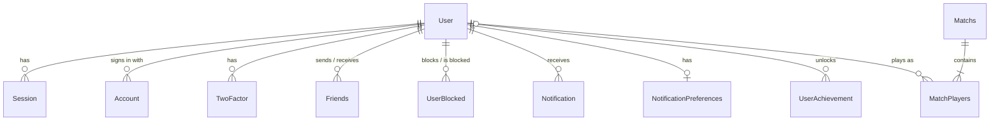

*This project has been created as part of the 42 curriculum by achauvie, tjourdai, gaeducas.*

# Sonar

## Description

**Sonar** is an online, turn-based naval battle game playable in the browser. Players hide their fleet on a 14x14 grid, then take turns firing at the enemy grids until only one fleet (or one team) is left afloat.

The goal of the project was to build a complete, multi-user web application around a game: real-time matches between remote players, social features (friends, private chat, notifications), ranked play with an Elo-based leaderboard, and a secure account system.

### Key features

- **Four game modes**: 1v1, 2v2 (with a private team chat), 4-player free-for-all, and a match against an AI opponent.
- **Public and private lobbies**: public matches are listed in the lobby, private ones are joined with a code or an invitation sent from the chat.
- **Customizable matches**: turn duration (10-60 s), visibility, spectators allowed or not, and replacement of leaving players by a bot.
- **Ranked play**: Elo rating adapted to team and free-for-all matches, 7 naval ranks, global and friends leaderboards.
- **Spectator mode**: watch public matches live.
- **Social features**: friends with online status, private messages with typing indicator and read receipts, blocking, public profiles, in-app and email notifications.
- **Accounts**: email/password with email verification, Google and Discord sign-in, two-factor authentication (TOTP + backup codes), avatar upload, data export and account deletion.
- **Three languages**: English, French and Spanish, switchable from the interface.

## Instructions

### Prerequisites

- [Docker](https://docs.docker.com/get-docker/) with Docker Compose v2
- GNU Make
- A Google Cloud OAuth client and a Discord application (for social sign-in)
- A Gmail account with an [app password](https://support.google.com/accounts/answer/185833) (for verification codes and notification emails)
- For development only: Node.js 22 and pnpm

### Configuration

Copy the example file and fill in every variable:

```sh
cp .env.example .env
```

| Variable | Description |
|---|---|
| `POSTGRES_USER`, `POSTGRES_PASSWORD`, `POSTGRES_DB` | PostgreSQL credentials |
| `BETTER_AUTH_SECRET` | Session signing secret, e.g. `openssl rand -hex 32` |
| `GOOGLE_CLIENT_ID`, `GOOGLE_CLIENT_SECRET` | Google OAuth client |
| `DISCORD_CLIENT_ID`, `DISCORD_CLIENT_SECRET` | Discord OAuth application |
| `GMAIL_USER`, `GMAIL_APP_PASSWORD` | Account used to send emails |

The OAuth providers must accept this redirect URL: `https://<HOST_IP>:8443/api/auth/callback/google` (and `/discord`). `HOST_IP` is the local IP of the machine running the project; the Makefile detects it automatically.

The `.env` file is ignored by Git and must never be committed.

### Run (production)

```sh
make
```

This single command builds and starts the three containers (PostgreSQL, backend, nginx + frontend), applies the database migrations and seeds the ranks. The site is then available at:

- `https://localhost:8443`
- `https://<HOST_IP>:8443` from another computer on the same network

The certificate is self-signed, so the browser shows a warning on the first visit. Port 8443 is used because binding port 443 requires root privileges on school computers.

Other commands:

| Command | Effect |
|---|---|
| `make detach` | Start in the background |
| `make down` | Stop the containers |
| `make logs` | Follow the logs |
| `make fclean` | Stop and delete the volumes (database included) |
| `make re` | Full rebuild from scratch |

### Run (development)

```sh
make dev                       # database + backend with hot reload on http://localhost:3000
cd frontend && pnpm install && pnpm dev   # frontend on http://localhost:5173
```

- `make migrate name=<migration_name>`: create a migration after editing `backend/prisma/schema.prisma`
- `make studio`: open Prisma Studio to browse the database

## Team Information

| Member | Login | Role(s) | Responsibilities |
|---|---|---|---|
| Alexis | `achauvie` | Product Owner, Developer | Defined the product vision, prioritized features and maintained the backlog, validated completed work. Main developer of the game engine and of the social features. |
| Tom | `tjourdai` | Technical Lead / Architect, Developer | Defined the architecture and the technology stack, reviewed critical changes. Developed ship deployment, account security, notifications and data features. |
| Gaël | `gaeducas` | Project Manager / Scrum Master, Developer | Organized meetings and planning, tracked progress and deadlines, removed blockers. Developed the AI opponent, internationalization and the notification interface, and led the security audits and fixes. |

> Developers: the whole team (Alexis, Tom and Gaël) implemented features, took part in code reviews, tested their work and documented it.

## Project Management

- **Work organization**: the project was split into features (game engine, ship deployment, accounts, social, notifications, translations, AI). Each member took ownership of features and the team synced regularly to review progress and blockers.
- **Meetings**: regular in-person meetings at 42.
- **Task tracking**: GitHub Issues / Projects.
- **Code**: GitHub repository with feature branches; important changes were reviewed by another member before merging.
- **Communication**: Discord.

## Technical Stack

| Layer | Technologies |
|---|---|
| Frontend | React 19, TypeScript, Vite, React Router 7, Tailwind CSS 4 + daisyUI 5, React Compiler, socket.io-client, react-icons, qrcode.react |
| Backend | Node.js 22, Express 5, TypeScript, Socket.IO 4, better-auth, Prisma 7 |
| Database | PostgreSQL 16 |
| Infrastructure | Docker Compose, nginx (HTTPS termination, reverse proxy for the API and WebSockets) |
| Other libraries | zxcvbn-ts (password strength), sharp (avatar resizing), nodemailer (emails), express-rate-limit |

**Justification of the main choices**

- **React + Express**: both are widely documented and known by the team, and TypeScript is shared between frontend and backend (the socket event types are the same on both sides).
- **Socket.IO**: rooms per user make it simple to push match updates, chat messages, presence and notifications, with automatic reconnection.
- **better-auth**: provides email/password, email OTP, OAuth, 2FA, session management and built-in rate limiting, instead of writing sensitive authentication code by hand.
- **PostgreSQL + Prisma**: the data is strongly relational (users, friendships, matches, players), PostgreSQL guarantees integrity with foreign keys and unique constraints, and Prisma gives typed queries and versioned migrations.
- **Tailwind + daisyUI**: fast, consistent and responsive styling with a shared theme.
- **nginx**: serves the built frontend and forces HTTPS for every browser connection, including WebSockets.

## Database Schema



| Table | Key fields | Notes |
|---|---|---|
| `user` | `id`, `email` (unique), `username` (unique), `image`, `language`, `points` (Int), `twoFactorEnabled`, `emailVerified` | Managed by better-auth; `points` is the Elo rating |
| `session` | `token` (unique), `expiresAt`, `ipAddress`, `userAgent`, `userId` -> user | Deleted with the user |
| `account` | `providerId` (credential / google / discord), `accountId`, hashed `password`, OAuth tokens, `userId` -> user | |
| `verification` | `identifier`, `value`, `expiresAt` | Email OTP codes |
| `twoFactor` | `secret`, `backupCodes`, `userId` -> user | |
| `friends` | `userId` -> user, `targetId` -> user, `isAccepted` (Boolean) | Unique pair `(userId, targetId)` |
| `userblocked` | `userId` -> user, `targetId` -> user | Unique pair |
| `conversations` | `userId`, `targetId`, `message`, `sendAt`, `isRead` | No foreign key on purpose: messages stay readable by the recipient after the sender deletes their account |
| `matchs` | `type` (enum `ONE_V_ONE`, `TWO_V_TWO`, `FFA`, `BOT`), `isRanked`, `startedAt`, `endedAt` | Finished matches only; running matches live in server memory |
| `matchplayers` | `matchsId` -> matchs, `userId` -> user (nullable), `isBot`, `team`, `placement`, `points` (Elo delta), `status` (enum `PLAYED`, `LEFT`), `shotsHit`, `shotsTotal` | `userId` becomes `NULL` when an account is deleted, keeping the match anonymized |
| `ranks` | `en_label`, `fr_label`, `es_label`, `min` (Int) | Seeded at startup (7 ranks) |
| `notifications` | `userId` -> user, `fromUserId` -> user, `title`, `description`, `params` (JSON), `read` | |
| `notification_preferences` | `userId` -> user, in-app and email toggles per category | |
| `user_achievements` | `userId` -> user, `achievementId`, `unlockedAt` | Unique pair `(userId, achievementId)` |

## Features List

| Feature | Description | Member(s) |
|---|---|---|
| Game engine | Server-authoritative turns, turn timer, shots, sinking, elimination, placement, match logs | Alexis, Tom, Gaël |
| Ship deployment | Drag and drop, rotation, random placement, server-side validation, automatic placement when the timer ends | Tom, Alexis |
| Lobbies | Public list, private matches with code, invitations, kick, ready system, lobby timeout | Alexis, Tom, Gaël |
| Match settings | Turn duration, visibility, spectators, bot replacement of leaving players | Alexis, Tom |
| Disconnections | 30 s grace period, reconnection to the running match, forfeit | Alexis, Gaël |
| AI opponent | "Hunt then target" strategy, also used to replace leaving players | Gaël |
| Team chat | Private chat between teammates in 2v2 | Alexis, Gaël |
| Spectator mode | Watch public matches live, without seeing the fleets | Alexis |
| Elo ranking | Team and free-for-all Elo, provisional players, anti-farming rules, rating gap limit for ranked lobbies | Alexis |
| Leaderboard & profile | Global and friends leaderboards, profile with rank, stats, match history and achievements | Alexis |
| Achievements | 7 achievements stored in the database, with notifications | Tom |
| Authentication | Email/password with verification code, Google and Discord sign-in, password reset | Alexis, Tom |
| Password policy | Minimum 12 characters and zxcvbn strength check on both sides | Alexis, Gaël |
| Two-factor authentication | TOTP with QR code, backup codes | Tom, Alexis |
| Account settings | Username, language, avatar upload (resized to WebP), active sessions | Alexis, Tom |
| Friends & chat | Requests, online status, private messages, typing indicator, read receipts, blocking | Alexis, Tom, Gaël |
| Notifications | Real-time toasts, notification center, per-category in-app and email preferences | Gaël, Tom |
| Data & privacy | JSON data export, account deletion with confirmation email, Privacy Policy and Terms of Service | Tom, Alexis, Gaël |
| Internationalization | English, French and Spanish for the interface and the emails | Gaël, Alexis, Tom |
| Security hardening | Rate limits, input validation, access checks, HTTPS, security headers | Gaël, Tom |

## Modules

| # | Module | Type | Points | Member(s) |
|---|---|---|---|---|
| 1 | Web - Frontend and backend frameworks | Major | 2 | All |
| 2 | Web - Real-time features with WebSockets | Major | 2 | Alexis, Tom, Gaël |
| 3 | Web - User interaction (chat, profiles, friends) | Major | 2 | Alexis, Tom |
| 4 | User Management - Standard user management | Major | 2 | Alexis, Tom |
| 5 | Artificial Intelligence - AI opponent | Major | 2 | Gaël |
| 6 | Gaming - Complete web-based game | Major | 2 | Alexis, Tom |
| 7 | Gaming - Remote players | Major | 2 | Alexis |
| 8 | Gaming - Multiplayer (more than two players) | Major | 2 | Alexis |
| 9 | Web - ORM | Minor | 1 | Alexis |
| 10 | Accessibility - Multiple languages | Minor | 1 | Gaël, Alexis, Tom |
| 11 | User Management - Game statistics and match history | Minor | 1 | Alexis |
| 12 | User Management - OAuth 2.0 | Minor | 1 | Alexis |
| 13 | User Management - Two-factor authentication | Minor | 1 | Tom |
| 14 | Gaming - Gamification | Minor | 1 | Tom, Alexis |
| 15 | Gaming - Spectator mode | Minor | 1 | Alexis |
| 16 | Data - GDPR compliance features | Minor | 1 | Tom |

**Total: 8 Major x 2 + 8 Minor x 1 = 24 points** (14 required, the rest counts as bonus, capped at 5 points).

### Justification and implementation

1. **Frameworks**: React 19 (frontend) and Express 5 (backend), both in TypeScript. Chosen for their ecosystem and the team's experience.
2. **WebSockets**: Socket.IO, authenticated with the session cookie. Each user joins a personal room, used to push match state, turn timers, chat messages, presence and notifications. Disconnections are handled with a grace period and the socket is closed when the session is revoked.
3. **User interaction**: private chat between friends stored in the database, public profiles, friend requests (send, accept, decline) and friends list with live status. Blocking a user removes them from your friends.
4. **Standard user management**: users can edit their username, language and avatar (default avatar if none), see friends' online status and have a profile page.
5. **Web-based game**: naval battle with clear rules: 5 ships per team (17 cells), one shot per turn, a fleet is eliminated when all its ships are sunk, the last fleet afloat wins. The server owns the game state; clients never receive the enemy fleets.
6. **Remote players**: every action goes through the server and is broadcast in real time. A disconnected player has 30 seconds to come back; reloading the page restores the running match and the remaining turn time.
7. **Multiplayer**: 2v2 (alternating turn order between teams, shared fleet, private team chat) and 4-player free-for-all with a placement for every player.
8. **ORM**: Prisma with a typed client and 38 versioned migrations.
9. **Multiple languages**: every interface text and email is translated into English, French and Spanish (551 keys per language), with a language switcher in the settings and automatic detection at sign-up.
10. **Statistics and match history**: matches played, win rate, shot accuracy, paginated history with opponents, results and Elo changes, rank and leaderboard position.
11. **OAuth 2.0**: Google and Discord sign-in through better-auth, with automatic account linking and avatar import.
12. **2FA**: TOTP (QR code for authenticator apps), backup codes protected by the password, and a 2FA code required to delete the account.
13. **Gamification**: achievements, ranks and leaderboards, stored in the database, with notifications when an achievement is unlocked.
14. **Spectator mode**: users can join any public running match that allows spectators and follow every shot in real time, without seeing the hidden fleets.
15. **GDPR**: data export in readable JSON, account deletion with confirmation (password and 2FA if enabled) and confirmation emails for exports and deletions.

## Individual Contributions

### Alexis (`achauvie`)

- Project setup: Docker, Makefile, Prisma schema and migrations, better-auth configuration.
- Authentication pages (login, sign-up, forgot password), Google and Discord sign-in, account settings.
- Game engine: match creation, lobbies, turn order and timer, firing, elimination, placements, logs, forfeit, disconnections, spectator mode, 2v2 team chat.
- Elo system, ranks, leaderboard, profile with statistics and match history.
- Friends page: private chat, conversations, read status, presence, search.
- **Challenges**: keeping the match state consistent between several clients and the server (reconnections, players leaving mid-turn); solved by making the server the only source of truth and pushing the filtered state to each player after every action.

### Tom (`tjourdai`)

- Ship deployment interface (drag and drop, rotation, random placement) and server-side fleet validation.
- Email verification with OTP codes, 2FA (activation, backup codes), avatar upload and processing.
- Friend management routes, notification system and preferences, emails.
- Achievements, data export, account deletion.
- Home page and design components (dock bar, radar animation).
- **Challenges**: validating fleets on the server so a modified client cannot cheat; solved with a strict check of each ship's size, alignment, overlap and grid bounds.

### Gaël (`gaeducas`)

- AI opponent (`backend/src/lib/matchs/bot/`) and the shared shot logic used by players and bots.
- Translation of the whole interface and of the emails into English, French and Spanish.
- Notification UI (toasts, notification center, mark as read, deletion).
- Security audits and fixes: access checks on every API route and socket event, input validation, rate limits, password policy, dependency updates, dead code removal.
- **Challenges**: the bot first played with a fake user id rejected by the database; solved by storing bots as players without a user (`userId = NULL`, `isBot = true`).

## Resources

### Documentation

- [React](https://react.dev/) and [React Router](https://reactrouter.com/)
- [Express 5](https://expressjs.com/)
- [Socket.IO](https://socket.io/docs/v4/)
- [better-auth](https://www.better-auth.com/docs)
- [Prisma](https://www.prisma.io/docs)
- [PostgreSQL](https://www.postgresql.org/docs/16/)
- [Tailwind CSS](https://tailwindcss.com/docs) and [daisyUI](https://daisyui.com/)
- [Docker Compose](https://docs.docker.com/compose/) and [nginx](https://nginx.org/en/docs/)
- [Battleship game strategy (hunt and target)](https://www.datagenetics.com/blog/december32011/)
- [GDPR overview (CNIL)](https://www.cnil.fr/en/gdpr-developers-guide)

### Use of AI

AI (Claude Design and Claude Code) was used as an assistant for the following tasks:

- **Frontend mockup**: the mockup of the interface was made with Claude Design. The team then reproduced the design by hand in React and Tailwind CSS; no generated frontend code was used.
- **Security reviews**: auditing the API routes and socket events, then proposing fixes (access checks, input validation, rate limits), which were reviewed and tested by the team.
- **Code review and dead code**: finding unused code, translation keys and dependencies.
- **Translations**: checking and completing the Spanish translations.